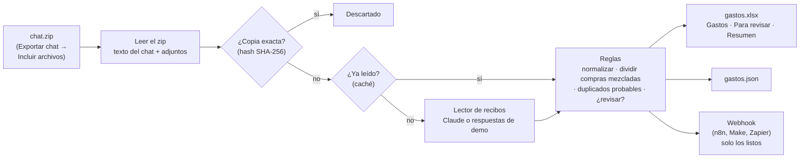

# recibos-whatsapp

Convierte las fotos de recibos de un grupo de WhatsApp en una planilla de gastos lista para revisar.

*Turns receipt photos from an exported WhatsApp chat into a reviewed expense spreadsheet. Node 24 + TypeScript, Claude vision with JSON-schema output, idempotent re-runs, webhook delivery with retries.*

## El problema

En muchos negocios chicos los socios se pasan las fotos de los tickets por WhatsApp. A fin de mes alguien las copia a mano a una planilla: tarda horas, se saltea alguna y carga otras dos veces.

Esta herramienta toma el chat exportado (con las fotos), lee cada comprobante y arma la planilla. Lo que está claro queda listo. Lo dudoso (foto borrosa, sin fecha, posible duplicado, en dólares) pasa a una hoja aparte con el motivo, para que una persona lo mire antes de que cuente como gasto.

Nació dentro de [Nexo](https://github.com/Logicode-Services), el sistema de ventas de Logicode, donde lo usamos en nuestro propio local. Acá está separado como herramienta independiente.

## Cómo funciona



| Caso | Qué hace |
| --- | --- |
| Compra normal, bien leída | Va a **Gastos** |
| Supermercado con comida y limpieza | Un gasto por categoría, que suman exacto el total |
| Nota de crédito o devolución | Gasto en negativo |
| Foto que no es un recibo | **Descartado** |
| Borrosa, sin fecha, en dólares, poca confianza | **Para revisar**, con el motivo |
| La misma compra fotografiada dos veces | **Para revisar** como posible duplicado |
| La misma foto reenviada | **Descartado** como copia exacta, sin volver a leerla |
| Foto en HEIC o de más de 5 MB | Error con la explicación de cómo arreglarlo |

## Probarlo en un minuto (sin clave)

Necesita Node 24 o más nuevo.

```bash
npm install
npm run demo
```

La demo usa `demo/chat-demo.zip`: un chat inventado con 9 adjuntos que cubren todos los casos de la tabla. Comercios, RUT y personas son ficticios. En modo `--demo` no se llama a ninguna API: el lector devuelve respuestas guardadas en `demo/respuestas/`, escritas a mano a partir de esas imágenes. Deja `salida-demo/gastos.xlsx` y `salida-demo/gastos.json`.

Para regenerar el zip: `python3 demo/generar-demo.py` (necesita Pillow).

## Con recibos reales

```bash
export ANTHROPIC_API_KEY=...
npm run recibos -- ruta/al/chat.zip --negocio "una ferretería" --salida gastos-noviembre
```

| Opción | Para qué |
| --- | --- |
| `--negocio <texto>` | Contexto para leer mejor ("una rotisería", "un taller mecánico") |
| `--categorias <archivo.json>` | Categorías propias: `[{ "key": "repuestos", "label": "Repuestos", "description": "..." }]`. Por defecto, 8 pensadas para comercio y gastronomía |
| `--webhook <url>` | Manda cada gasto listo por POST (JSON) |
| `--webhook-secreto <s>` | Va como `Authorization: Bearer <s>` |
| `--concurrencia <n>` | Recibos que se leen a la vez (por defecto 3) |
| `--sin-cache` | Vuelve a leer todo |

Volver a correrlo con el chat exportado de nuevo es seguro: lo ya leído sale de la caché (`<salida>/.cache`) y no se vuelve a pagar.

### Conectarlo con n8n

1. En n8n, un nodo **Webhook** (POST) seguido de **Google Sheets → Append row** (o el destino que uses).
2. `npm run recibos -- chat.zip --webhook https://tu-n8n/webhook/gastos --webhook-secreto ...`
3. Cada gasto llega como un JSON con `id`, `date`, `vendor`, `amount`, `category`, etc. El encabezado `Idempotency-Key` repite el `id`. Si el receptor lo guarda, un reenvío no duplica filas.

## Decisiones técnicas

Resumen. El detalle, con las alternativas descartadas, está en [docs/decisiones.md](docs/decisiones.md).

- **Puertos y adaptadores.** El flujo depende de una interfaz `ReceiptExtractor`, no de Claude. Hay dos implementaciones: la real y una con respuestas guardadas. Así la demo y los tests corren sin red ni costo.
- **Salida con esquema JSON.** Claude responde con un esquema fijo: los campos, los tipos y las categorías posibles los garantiza la API. Lo que el esquema no puede garantizar (fechas imposibles, montos negativos) lo corrige `normalizeReceipt`.
- **Una persona revisa lo dudoso.** Nada entra como gasto si hubo que suponer algo. El modelo puede equivocarse, y un número mal leído en las finanzas sale más caro que mirarlo un minuto.
- **Idempotencia.** Cada foto se identifica por el hash de su contenido. La caché usa como clave ese hash más la versión del prompt y las categorías: si cambia el prompt, se vuelve a leer. El webhook manda `Idempotency-Key`.
- **Errores aislados y reintentos con criterio.** Una foto que falla no frena la tanda. El webhook reintenta 429, 5xx y cortes de red con espera creciente y respeta `Retry-After`. Un 4xx no se reintenta: reintentar no arregla un pedido mal armado.
- **Concurrencia limitada.** 3 lecturas a la vez por defecto, para no chocar con el límite de pedidos de la API.
- **Sin compilación.** Node 24 ejecuta TypeScript directo. `tsc` solo verifica tipos.

## Estructura

```
src/
  cli.ts               entrada: argumentos, arma el flujo, imprime el resultado
  pipeline.ts          zip → lectura (con caché y concurrencia) → reglas → filas
  chat-export.ts       parser del texto del chat (iPhone/Android, es/en)
  zip.ts               abre el export y empareja cada foto con su mensaje
  rules.ts             normalización, división por categoría, duplicados, revisión
  cache.ts             caché de lecturas en disco
  categories.ts        categorías por defecto y carga desde JSON
  extract/             el puerto (types.ts) y sus adaptadores: claude.ts, fixtures.ts
  output/              records.ts (forma común), xlsx.ts, webhook.ts
tests/                 25 tests (Vitest): parser, reglas, webhook, flujo completo
demo/                  generador del chat de demo y respuestas guardadas
```

```bash
npm run check   # tipos + tests, lo mismo que corre la CI
```

## Estado

- La lógica, la demo y los tests están completos y corren en la CI.
- El adaptador de Claude reusa el de Nexo y compila contra los tipos del SDK, pero en este repo todavía no se probó contra la API con recibos reales.
- No lee HEIC. En el iPhone: Ajustes → Cámara → Formatos → Más compatible.

## Licencia

MIT. Hecho por [Logicode](https://github.com/Logicode-Services).
